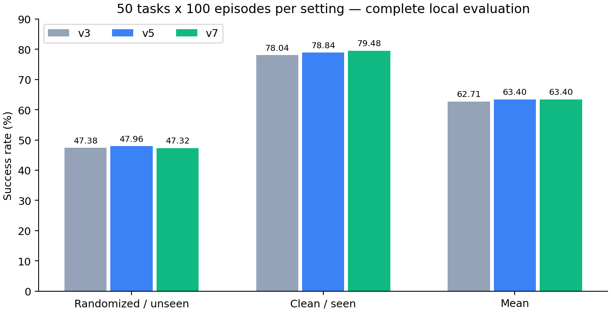
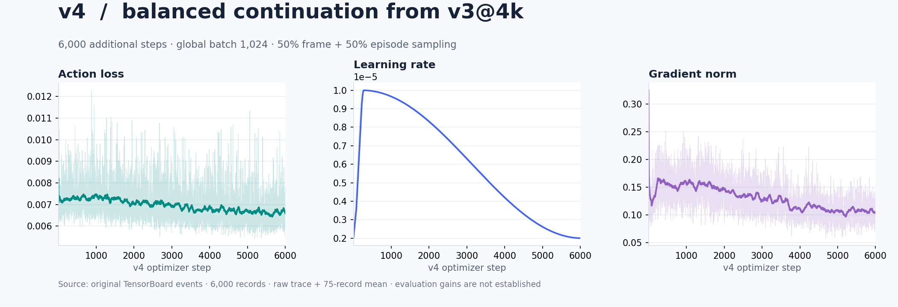
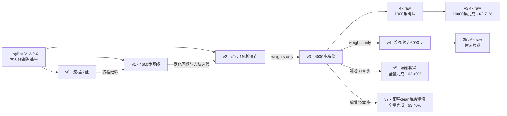
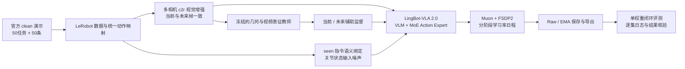

# LingBot-VLA 2.0 · RoboTwin 50任务联合训练与泛化评测

基于官方LingBot-VLA 2.0（6B）的全参数后训练项目，公开训练配方、恢复机制、评测协议与逐集证据。**最终选用v7@2000 raw，完整本地10000集均分63.40%。**

[最终方案](docs/FINAL_METHOD.md) · [完整任务对比](docs/FINAL_TASK_RESULTS.md) · [评测历史](docs/EVALUATION_HISTORY.md) · [复现指南](docs/REPRODUCIBILITY.md) · [数据与统计溯源](docs/DATA_PROVENANCE.md)

## 最终成绩：v5与v7均已完成全量

| 模型 | randomized/unseen | clean/seen | 双场均分 |
| --- | ---: | ---: | ---: |
| v3@4k raw | 2369/5000 · 47.38% | 3902/5000 · 78.04% | 62.71% |
| v5@3k raw | 2398/5000 · **47.96%** | 3942/5000 · 78.84% | **63.40%** |
| **v7@2k raw · 最终选择** | 2366/5000 · 47.32% | 3974/5000 · **79.48%** | **63.40%** |

每版50任务×2setting×100有效回合。v7相对v3均分+0.69pp；v5/v7总分相同，v7clean多成功32集，randomized少成功32集。按clean优先选择v7，不声称其总分超过v5。本地评测不是官方排名，也不是严格逐seed配对。



[v5官方格式JSON](results/evaluation/v5_full100.json) · [v7官方格式JSON](results/evaluation/v7_full100.json) · [v5逐集记录](results/evaluation/v5_full100_episodes.jsonl) · [v7重启后的逐集记录](results/evaluation/v7_full100_episodes.jsonl) · [机器可读对比](results/evaluation/final_comparison.json)

v5北京时间10月24日10:22完成；v7北京时间10月24日19:16完成。v5恢复保留已完成成败回合；v7只计当前成功重启10000集，旧约624集排除。

## 最后一次方案：完整clean混合精修

谱系：官方预训练基座 → v2@19k → v3新增4k → v7新增2k。v5是从v3继续3k的另一分支；v6停止尝试不作为已完成对照。

- 每条样本50%概率保留完整clean当前/未来三相机并关闭该样本state noise；50%使用原C2R与原state noise。动作监督来自官方clean演示，语言仅release seen。
- v7关闭局部擦除；独立DP rank flow noise/time RNG及其恢复状态。单个最终候选，没有另训消融归因。
- 独立8卡、global1024=8×32×4，Muon/L1_fm/FP32、200步warmup2e-6→5e-6、cosine至1e-6、2000步raw。
- 保留原配套统计及原生冻结Depth/Video辅助监督；重算clean统计附件未启用。
- 推理单权重、FP32/compile/chunk50/exec30/denoise10，randomized→clean，逐进程Warp缓存，规划器初始化失败立即中止。

[完整配方](docs/FINAL_METHOD.md) · [v7可执行配置](configs/v7.yaml) · [v5可执行配置](configs/v5.yaml) · [历史遮挡提案的实施结果](docs/NEXT_TRAINING_PLAN.md)

## 历史训练与评测

下列训练曲线及v0–v4档案保留实验演进；不同执行长度、指令类型及样本量不能直接算同口径收益。[v5](docs/evaluation/v5.md) · [v6停止记录](docs/evaluation/v6.md) · [v7](docs/evaluation/v7.md)。源码按Apache-2.0发布，第三方许可见[THIRD_PARTY](THIRD_PARTY.md)。仓库提供代码/配方/证据，不包含大权重、官方数据或比赛提交ZIP；官方提交/排名以平台回执为准。

## 训练曲线

项目围绕同一个问题逐步推进：先把完整训练链路跑通，再建立50任务基线，随后改善跨场景泛化，最后进行低学习率精修和扩大样本确认。下图按阶段分别展示动作loss与学习率；各阶段使用独立优化步横轴。


### v0 · 打通训练与保存链路

最初从官方预训练基座开始，使用clean演示完成**1000步**流程验证：micro8 × 2卡 × accum16 = **global256**，Muon，LR **5e-5**。这一阶段验证数据读取、原生辅助监督、分布式训练和checkpoint保存，为正式基线提供可运行的起点。

v0没有用于代表最终性能的完整确认成绩。[原始训练指标](results/training/v0_tensorboard.csv)与[配置档案](configs/history/v0_original.yaml)均保留。

### v1 · 4600步正式基线

在流程验证之后，v1重新从**LingBot-VLA 2.0官方基座**训练，建立覆盖全部50任务的无视觉增强基线。实际训练**4600步**，原配置为micro32 × 8卡 × accum4 = **global1024**，Muon，cosine学习率 **1e-4 → 5e-5**。


训练loss持续下降，但历史全50任务×5集评测中，clean为 **152/250 = 60.8%**，randomized为 **86/250 = 34.4%**。跨场景落差促使下一阶段研究视觉泛化，而不只是继续增加基线训练步数。

这组历史评测两边均使用**unseen指令、exec50**；不能与当前clean/seen、exec30的确认分直接计算同口径增益。v1当时的W&B同步因NumPy兼容问题失败，图表从完整TensorBoard事件恢复；重启重复记录按每个(step, metric)保留最新观测，未补点。

[4600步指标CSV](results/training/v1_tensorboard.csv) · [曲线来源](results/training/v1_provenance.json) · [原始配置](configs/history/v1_original.yaml) · [4卡便携配置](configs/v1.yaml) · [逐任务结果](results/evaluation/v1_4600_exec50.json)

### v2 · 用c2r增强改善视觉泛化

针对v1观察到的跨场景差距，v2从同一官方基座**重新训练**，保留Muon、global1024、动作损失与原生几何/视频监督，引入c2r多视角增强：光度、通道统计和频域扰动；同一相机的当前帧与未来帧复用参数，并按相机保留20%原图直通。

v2使用**20k步学习率日程**，选取**19k检查点**。它继承v1的实验经验，权重并不从v1继续。


历史exec50、两边unseen协议下，全50任务×5集为clean **194/250 = 77.6%**、randomized **122/250 = 48.8%**。后续采用exec30并纠正clean指令口径后，v2@19k记录为 **78.4 / 47.2**。这些结果按各自协议保存。

早期面板支持保留视觉增强；中后期训练loss继续下降，而闭环收益趋于平台，促使项目转向低学习率精修。训练量和日程等条件并未完全控制，因此不把v1到v2的全部差值归因于c2r。

[19000步指标CSV](results/training/v2_tensorboard.csv) · [来源与重启处理](results/training/v2_provenance.json) · [W&B运行](https://wandb.ai/3120252125-/ant-lingbot-competition/runs/sft-v2-aug-c2r-v1-clean2500-20k) · [训练配置](configs/v2.yaml) · [历史逐任务结果](results/evaluation/v2_19000_exec50.json)

### v3 · 低学习率精修、选型与确认

v3以 **v2@19k raw权重**初始化，重新建立优化器与调度器，训练**4000步**，cosine学习率 **2e-5 → 2e-6**。保留c2r，加入seen语义绑定和关节状态噪声；同时维护EMA，在2k与4k保存raw/EMA候选。

[](https://wandb.ai/3120252125-/ant-lingbot-competition/runs/sft-v3-tail-v1-clean2500-parent19000-r2)

通过检查点选型后采用**4k raw**，再完成全部50任务×2setting×10集确认，得到 **clean/seen 80.8%、randomized/unseen 50.4%、等权均值65.6%**。2k EMA与4k EMA的表现不同，选型保留了负结果，没有将EMA简单判定为普遍有效或无效。

v3图表直接来自已结束的W&B运行，导出**3998条指标记录，覆盖step1–4000**。浅色为原始值，深色为75条记录滑动均值；缺失点未填补。W&B访问沿用原项目权限，仓库内图片与CSV可直接查看。

[W&B原始运行](https://wandb.ai/3120252125-/ant-lingbot-competition/runs/sft-v3-tail-v1-clean2500-parent19000-r2) · [指标CSV](results/training/v3_wandb.csv) · [导出来源](results/training/v3_wandb_provenance.json) · [训练配置](configs/v3.yaml) · [检查点选型记录](docs/EXPERIMENTS.md)

### v4 · 演示均衡续训与候选筛选

从**v3@4k raw**加载权重，新建优化器/调度，实际新增**6000步**，global1024；200步warmup从2e-6到1e-5，随后cosine降至2e-6。采样改为50%帧均匀＋50%演示均匀后取帧，保留c2r、seen绑定、状态扰动和原配套归一化。



3k和6k raw/EMA均已导出。3k raw的randomized全50任务×10集为**245/500=49.0%**，此前v3同规模为50.4%；3k clean与6k randomized提前停止，不能给出完整双场均分，也不能据部分结果断言6k最终优劣。该历史记录没有证明均衡续训带来提分；后续最终候选另从v3出发。

[v4全部评测与逐任务结果](docs/evaluation/v4.md) · [6000步原始指标](results/training/v4_tensorboard.csv) · [曲线来源](results/training/v4_tensorboard.provenance.json) · [实际训练配方摘要](results/training/v4_recipe.json)

v4在此作为已执行的研究阶段归档；便携训练入口覆盖v1–v3与最终v5/v7；v4采样仍作为历史研究记录。

### 权重谱系与经验迭代



项目经验按v0→v7积累；v5和v7各自从v3继续，v7不继承v5/v6。实际初始化关系按图中的实线记录。训练loss用于复盘优化过程，模型选择依据闭环成功率。

## 方法实现



**视觉泛化。**训练期引入逐相机采样的光度、通道统计和频域扰动；同一相机的当前帧/未来帧复用参数。每相机保留20%原图直通，将hue范围限制为±0.03，避免颜色语义任务的监督被破坏。实现：[augment.py](overlays/lingbot-vla-v2/lingbotvla/data/vla_data/augment.py)。

**语言与状态正则。**从官方seen模板恢复对象、手臂和空间关系，按episode绑定候选指令；歧义匹配保留原句。2159/2500条轨迹具备有效替换候选。状态噪声仅施加于有效连续关节，动作目标、夹爪和补齐维度保持原义。实现：[seen_bindings.py](overlays/lingbot-vla-v2/lingbotvla/data/vla_data/seen_bindings.py)、[数据变换](overlays/lingbot-vla-v2/lingbotvla/data/vla_data/utils.py)。

**阶段续训与恢复。**v3从v2@19k权重初始化，重建优化器和调度器，执行4000步cosine精修。阶段契约绑定父权重路径、配方与seen清单摘要；保存worker随机数、优化器与分片EMA状态，拒绝不兼容恢复。实现：[training_stage.py](overlays/lingbot-vla-v2/lingbotvla/checkpoint/training_stage.py)、[ema.py](overlays/lingbot-vla-v2/lingbotvla/checkpoint/ema.py)。

**评测可信度。**显式绑定clean→seen、randomized→unseen，缩短测试回合数时仍保持100条描述生成规模；记录专家筛选和策略成败，交叉检查实际回合、结果和日志。支持显式GPU映射、服务就绪检查及CPU线程控制。

完整设计与取舍见[方法说明](docs/METHOD.md)。

## 快速查看与复现

仅查看实验记录和重绘图表，无需GPU：

```bash
python -m pip install -r requirements-report.txt
python scripts/verify_results.py
python scripts/verify_evaluation_history.py
python scripts/plot_results.py
python scripts/build_evaluation_report.py
```

更新静态快照及全版本档案的方法见[报告维护说明](docs/REPORTING.md)。

准备固定版本上游源码并应用项目改动：

```bash
python scripts/setup_sources.py
# 按 docs/REPRODUCIBILITY.md 安装官方训练/仿真环境及模型、数据资产
python scripts/train.py --stage v3 --gpus 0,1,2,3 --dry-run
```

训练与评测入口分别为 `train.sh`、`eval.sh`；先查实际GPU占用，训练与评测串行。当前发布版完成了CPU与入口检查，完整硬件复现沿用已验证的工作区流程；跨机器从零复现仍需目标环境验证。详细步骤见[复现指南](docs/REPRODUCIBILITY.md)。

## 真机演示

附带一个独立的双臂字母块排列演示，用于展示语言条件化操作与多机位观测。它使用独立真机数据，不参与上面的RoboTwin训练或分数计算。

[](assets/demo/demo.mp4)

[观看完整演示](assets/demo/demo.mp4) · [演示说明](docs/DEMO.md)

## 仓库结构

```text
configs/          可迁移训练配方、版本锁与历史统计
scripts/          训练、评测、结果验证、制图与W&B同步
train.sh eval.sh  运行入口
overlays/         叠加到固定上游版本的项目改动
results/          W&B标量、确认结果、逐集记录与来源
assets/           曲线图、任务图和演示
runtime_patches/  H100 cuRobo运行时兼容处理
tests/            增强、语义绑定、EMA与恢复检查
docs/             方法、实验、工程设计与复现记录
```

模型权重、演示数据、仿真大资产和运行环境按原始发布渠道准备，不随代码仓库分发。

## 上游与许可

基于 [LingBot-VLA 2.0](https://github.com/Robbyant/lingbot-vla-v2) 与 [RoboTwin](https://github.com/RoboTwin-Platform/RoboTwin)，参与[天池蚂蚁灵波具身大模型挑战赛](https://tianchi.aliyun.com/competition/entrance/532514)。原生模型结构与预训练能力归属于上游；本仓库记录后训练、数据正则、恢复、实验追踪及评测工程改动。

代码采用Apache-2.0；上游和RoboTwin相关许可见[第三方说明](THIRD_PARTY.md)。
