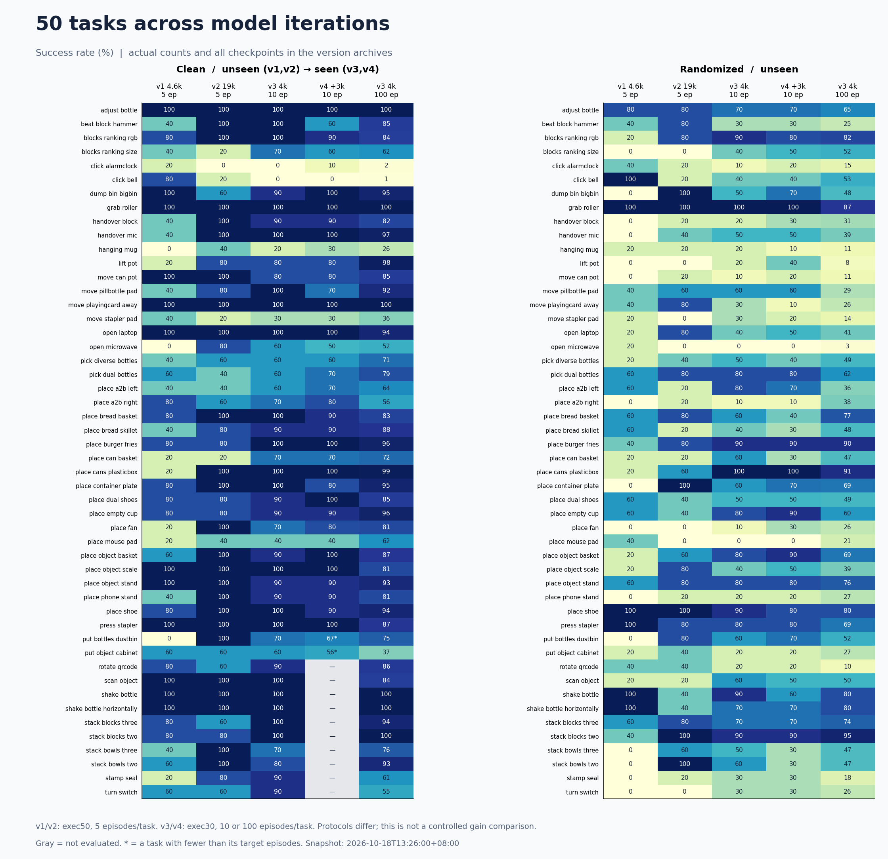
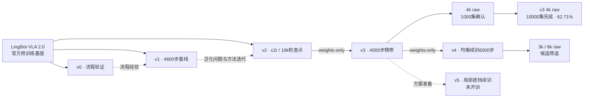
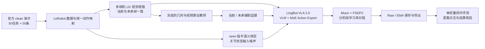

# LingBot-VLA 2.0 · RoboTwin 联合训练与泛化评测

基于 **LingBot-VLA 2.0（6B）** 的具身模型后训练项目：从数据接入、视觉与状态增强、分布式训练，到检查点选型、闭环评测和实验追踪，构建一条可审计的 RoboTwin 50 任务联合训练流程。

**Full-parameter post-training · Multi-view augmentation · Stateful checkpointing · Closed-loop evaluation**

[下一版训练方案](docs/NEXT_TRAINING_PLAN.md) · [项目演进](#项目演进) · [全版本评测档案](docs/EVALUATION_HISTORY.md) · [任务成功率](docs/TASK_RESULTS.md) · [成功与失败case](docs/EVALUATION_CASES.md) · [训练曲线](#训练曲线) · [复现指南](docs/REPRODUCIBILITY.md)


## 下一版：局部遮挡鲁棒性

**当前状态：方案准备，未开训。** 从v3 4k raw出发，保留现有训练与推理配方，以低概率局部视觉缺失作为新增训练条件。

- 初始提案：10%的样本随机影响一路相机，在该视角擦除2%–5%面积；其余视角保留。
- 同一相机当前/未来帧复用遮挡；学生读取遮挡图，冻结教师读取新增遮挡前的图像。
- 单个候选预算2000–3000步；固定最终日程后执行，不增加对照组或参数网格。先randomized/unseen，再clean/seen确认。
- 沿用v3对应权重与原统计，默认训练至多4卡；训练和评测串行。达到确认标准后再安排新权重百集评测。

遮挡按赛事允许的训练期像素退化方式实施；本页参数是待验证方案，尚无新训练成绩。完整设计、研究依据、接入检查与时间预算见[下一版训练方案](docs/NEXT_TRAINING_PLAN.md)。

## 项目演进

项目按 **v0流程验证 → v1正式基线 → v2视觉泛化 → v3精修与确认 → v4均衡续训与筛选** 连续迭代。每一阶段都保留训练配置、指标来源、观察到的问题和下一步决策。

| 阶段 | 核心工作 | 实际训练 | 形成的下一步依据 |
|---|---|---|---|
| v0 | 打通数据、监督、训练和保存链路 | 1000步，global256 | 从可运行流程进入正式训练 |
| **v1** | **无视觉增强的全50任务基线** | **4600步，global1024** | 历史clean60.8/randomized34.4，识别泛化缺口 |
| v2 | c2r多视角视觉增强 | 20k日程，选19k检查点 | 泛化改善后进入平台期，转向精修 |
| v3 | 低LR、seen绑定、状态噪声；raw/EMA选型 | 从v2@19k权重续训4000步 | 4k raw完成10000集全量，均值62.71；十集65.6作为历史确认 |
| v4 | 50%帧均匀＋50%演示均匀采样，保留原增强 | 从v3@4k新增6000步，累计29k | 3k randomized十集49.0%；6k筛选未完成，尚无已确认收益 |

阶段编号是项目版本，基座均为LingBot-VLA 2.0。v0、v1、v2分别从官方基座初始化，v3继承v2、v4继承v3；研究过程连续，权重谱系按实际记录展示。历史v1两setting都用unseen指令、exec50，不能与当前确认分直接作同口径涨幅计算。当前主模型v3 4k raw已完成每任务100集全量评测；下一版从该权重准备局部遮挡续训。

各阶段的训练过程和曲线在下文直接展开；[训练历程档案](docs/TRAINING_HISTORY.md)保留更详细的来源与复现记录。

## 实验结果

当前选定模型为 **v3 · step 4000 · raw**。2026-10-18 12:40（北京时间）完成全部 **50任务 × 2 setting × 100集** 全量评测，成功数来自逐集策略执行记录，并与任务结果文件及日志交叉核验。

| Setting | 指令 | 成功 / 实际回合 | 成功率 |
|---|---|---:|---:|
| Clean | seen | 3902 / 5000 | **78.04%** |
| Randomized | unseen | 2369 / 5000 | **47.38%** |
| 两 setting 等权均值 | — | 6271 / 10000 | **62.71%** |

推理配置：**FP32、动作块50、执行前30步后重新观测、10步去噪、torch.compile**。一份权重覆盖全部50任务。

这是完整本地评测结果，官方排名以赛事复测为准。旧十集确认80.80/50.40/65.60与本轮百集相比，分别下降2.76/3.02/2.89个百分点；同一权重扩样并重新运行，不属于严格逐集配对。历史5集67.4单独归档。训练使用官方clean2500演示，实际配套统计见[数据与统计记录](docs/DATA_PROVENANCE.md)。

- [百集最终结果](results/evaluation/v3_full100.json) · [10000集逐集记录](results/evaluation/v3_full100_episodes.jsonl) · [旧十集结果](results/evaluation/v3_confirmation.json) · [十集/百集对比](results/evaluation/v3_10eps_vs_100eps.json)
- [逐任务可视化](assets/figures/task_breakdown.png) · [检查点选型与负结果](docs/EXPERIMENTS.md)

<!-- EVALUATION_REPORT:START -->

### 从v0到v4：全部评测记录

[v0 流程验证](docs/evaluation/v0.md) · [v1 基线](docs/evaluation/v1.md) · [v2 增强与检查点扫描](docs/evaluation/v2.md) · [v3 精修与扩样](docs/evaluation/v3.md) · [v4 均衡续训](docs/evaluation/v4.md)

已归档现存 **72个评测目录**，包括零结果启动、面板、未完成评测、raw/EMA选型与负结果。每个版本页面均可展开各次运行的全部任务成绩。[迭代总览](docs/EVALUATION_HISTORY.md) · [所有版本逐任务CSV](results/evaluation/all_task_results.csv)


### 50任务成功率：跨版本展示

图中每格为成功率，灰色表示未测；星号表示尚未测满目标回合。v1/v2采用exec50且clean也为unseen，v3/v4采用exec30和clean/seen，因此跨版本图用于展示实验过程，不代表严格同条件增益。



### 最新评测快照

**更新时间：2026-10-18T13:26:00+08:00**。v3百集全量已完成：clean 78.04%、randomized 47.38%、双场均分62.71%。v4未完成筛选保留实际进度。

| 评测 | Setting / 指令 | 状态 | 测满任务 | 已记录回合 | 完整任务子集成功率 |
| --- | --- | --- | --- | --- | --- |
| v3 4k raw · 100集全量 | randomized/unseen | 完成 | 50/50 | 5000/5000 | 47.38% (2369/5000) |
| v3 4k raw · 100集全量 | clean/seen | 完成 | 50/50 | 5000/5000 | 78.04% (3902/5000) |
| v4 3k raw · 10集筛选 | randomized/unseen | 完成 | 50/50 | 500/500 | 49.00% (245/500) |
| v4 3k raw · 10集筛选 | clean/seen | 已停止 | 38/50 | 398/500 | 77.37% (294/380) |
| v4 6k raw · 10集筛选 | randomized/unseen | 已停止 | 18/50 | 185/500 | 41.11% (74/180) |
| v4 6k raw · 10集筛选 | clean/seen | 未开始 | 0/50 | 0/500 | — |

“已记录回合”包含未满任务；最右列只汇总已测满的任务，部分任务集合的成功率不能当作完整50任务成绩。

<details>
<summary>展开v3全部50任务：十集确认与百集结果</summary>

| 任务 | v3 clean/seen · 10集 | v3 randomized/unseen · 10集 | v3 randomized/unseen · 100集 | v3 clean/seen · 100集 | randomized差值 | clean差值 |
| --- | --- | --- | --- | --- | --- | --- |
| `adjust_bottle` | 100.00% (10/10) | 70.00% (7/10) | 65.00% (65/100) | 100.00% (100/100) | -5.0 pp | +0.0 pp |
| `beat_block_hammer` | 100.00% (10/10) | 30.00% (3/10) | 25.00% (25/100) | 85.00% (85/100) | -5.0 pp | -15.0 pp |
| `blocks_ranking_rgb` | 100.00% (10/10) | 90.00% (9/10) | 82.00% (82/100) | 84.00% (84/100) | -8.0 pp | -16.0 pp |
| `blocks_ranking_size` | 70.00% (7/10) | 40.00% (4/10) | 52.00% (52/100) | 62.00% (62/100) | +12.0 pp | -8.0 pp |
| `click_alarmclock` | 0.00% (0/10) | 10.00% (1/10) | 15.00% (15/100) | 2.00% (2/100) | +5.0 pp | +2.0 pp |
| `click_bell` | 0.00% (0/10) | 40.00% (4/10) | 53.00% (53/100) | 1.00% (1/100) | +13.0 pp | +1.0 pp |
| `dump_bin_bigbin` | 90.00% (9/10) | 50.00% (5/10) | 48.00% (48/100) | 95.00% (95/100) | -2.0 pp | +5.0 pp |
| `grab_roller` | 100.00% (10/10) | 100.00% (10/10) | 87.00% (87/100) | 100.00% (100/100) | -13.0 pp | +0.0 pp |
| `handover_block` | 90.00% (9/10) | 20.00% (2/10) | 31.00% (31/100) | 82.00% (82/100) | +11.0 pp | -8.0 pp |
| `handover_mic` | 100.00% (10/10) | 50.00% (5/10) | 39.00% (39/100) | 97.00% (97/100) | -11.0 pp | -3.0 pp |
| `hanging_mug` | 20.00% (2/10) | 20.00% (2/10) | 11.00% (11/100) | 26.00% (26/100) | -9.0 pp | +6.0 pp |
| `lift_pot` | 80.00% (8/10) | 20.00% (2/10) | 8.00% (8/100) | 98.00% (98/100) | -12.0 pp | +18.0 pp |
| `move_can_pot` | 80.00% (8/10) | 10.00% (1/10) | 11.00% (11/100) | 85.00% (85/100) | +1.0 pp | +5.0 pp |
| `move_pillbottle_pad` | 100.00% (10/10) | 60.00% (6/10) | 29.00% (29/100) | 92.00% (92/100) | -31.0 pp | -8.0 pp |
| `move_playingcard_away` | 100.00% (10/10) | 30.00% (3/10) | 26.00% (26/100) | 100.00% (100/100) | -4.0 pp | +0.0 pp |
| `move_stapler_pad` | 30.00% (3/10) | 30.00% (3/10) | 14.00% (14/100) | 36.00% (36/100) | -16.0 pp | +6.0 pp |
| `open_laptop` | 100.00% (10/10) | 40.00% (4/10) | 41.00% (41/100) | 94.00% (94/100) | +1.0 pp | -6.0 pp |
| `open_microwave` | 60.00% (6/10) | 0.00% (0/10) | 3.00% (3/100) | 52.00% (52/100) | +3.0 pp | -8.0 pp |
| `pick_diverse_bottles` | 60.00% (6/10) | 50.00% (5/10) | 49.00% (49/100) | 71.00% (71/100) | -1.0 pp | +11.0 pp |
| `pick_dual_bottles` | 60.00% (6/10) | 80.00% (8/10) | 62.00% (62/100) | 79.00% (79/100) | -18.0 pp | +19.0 pp |
| `place_a2b_left` | 60.00% (6/10) | 80.00% (8/10) | 36.00% (36/100) | 64.00% (64/100) | -44.0 pp | +4.0 pp |
| `place_a2b_right` | 70.00% (7/10) | 10.00% (1/10) | 38.00% (38/100) | 56.00% (56/100) | +28.0 pp | -14.0 pp |
| `place_bread_basket` | 100.00% (10/10) | 60.00% (6/10) | 77.00% (77/100) | 83.00% (83/100) | +17.0 pp | -17.0 pp |
| `place_bread_skillet` | 90.00% (9/10) | 40.00% (4/10) | 48.00% (48/100) | 88.00% (88/100) | +8.0 pp | -2.0 pp |
| `place_burger_fries` | 100.00% (10/10) | 90.00% (9/10) | 90.00% (90/100) | 96.00% (96/100) | +0.0 pp | -4.0 pp |
| `place_can_basket` | 70.00% (7/10) | 60.00% (6/10) | 47.00% (47/100) | 72.00% (72/100) | -13.0 pp | +2.0 pp |
| `place_cans_plasticbox` | 100.00% (10/10) | 100.00% (10/10) | 91.00% (91/100) | 99.00% (99/100) | -9.0 pp | -1.0 pp |
| `place_container_plate` | 100.00% (10/10) | 60.00% (6/10) | 69.00% (69/100) | 95.00% (95/100) | +9.0 pp | -5.0 pp |
| `place_dual_shoes` | 90.00% (9/10) | 50.00% (5/10) | 49.00% (49/100) | 85.00% (85/100) | -1.0 pp | -5.0 pp |
| `place_empty_cup` | 90.00% (9/10) | 80.00% (8/10) | 60.00% (60/100) | 96.00% (96/100) | -20.0 pp | +6.0 pp |
| `place_fan` | 70.00% (7/10) | 10.00% (1/10) | 26.00% (26/100) | 81.00% (81/100) | +16.0 pp | +11.0 pp |
| `place_mouse_pad` | 40.00% (4/10) | 0.00% (0/10) | 21.00% (21/100) | 62.00% (62/100) | +21.0 pp | +22.0 pp |
| `place_object_basket` | 90.00% (9/10) | 80.00% (8/10) | 69.00% (69/100) | 87.00% (87/100) | -11.0 pp | -3.0 pp |
| `place_object_scale` | 100.00% (10/10) | 40.00% (4/10) | 39.00% (39/100) | 81.00% (81/100) | -1.0 pp | -19.0 pp |
| `place_object_stand` | 90.00% (9/10) | 80.00% (8/10) | 76.00% (76/100) | 93.00% (93/100) | -4.0 pp | +3.0 pp |
| `place_phone_stand` | 90.00% (9/10) | 20.00% (2/10) | 27.00% (27/100) | 81.00% (81/100) | +7.0 pp | -9.0 pp |
| `place_shoe` | 100.00% (10/10) | 90.00% (9/10) | 80.00% (80/100) | 94.00% (94/100) | -10.0 pp | -6.0 pp |
| `press_stapler` | 100.00% (10/10) | 80.00% (8/10) | 69.00% (69/100) | 87.00% (87/100) | -11.0 pp | -13.0 pp |
| `put_bottles_dustbin` | 70.00% (7/10) | 60.00% (6/10) | 52.00% (52/100) | 75.00% (75/100) | -8.0 pp | +5.0 pp |
| `put_object_cabinet` | 60.00% (6/10) | 20.00% (2/10) | 27.00% (27/100) | 37.00% (37/100) | +7.0 pp | -23.0 pp |
| `rotate_qrcode` | 90.00% (9/10) | 20.00% (2/10) | 10.00% (10/100) | 86.00% (86/100) | -10.0 pp | -4.0 pp |
| `scan_object` | 100.00% (10/10) | 60.00% (6/10) | 50.00% (50/100) | 84.00% (84/100) | -10.0 pp | -16.0 pp |
| `shake_bottle` | 100.00% (10/10) | 90.00% (9/10) | 80.00% (80/100) | 100.00% (100/100) | -10.0 pp | +0.0 pp |
| `shake_bottle_horizontally` | 100.00% (10/10) | 70.00% (7/10) | 80.00% (80/100) | 100.00% (100/100) | +10.0 pp | +0.0 pp |
| `stack_blocks_three` | 100.00% (10/10) | 70.00% (7/10) | 74.00% (74/100) | 94.00% (94/100) | +4.0 pp | -6.0 pp |
| `stack_blocks_two` | 100.00% (10/10) | 90.00% (9/10) | 95.00% (95/100) | 100.00% (100/100) | +5.0 pp | +0.0 pp |
| `stack_bowls_three` | 70.00% (7/10) | 50.00% (5/10) | 47.00% (47/100) | 76.00% (76/100) | -3.0 pp | +6.0 pp |
| `stack_bowls_two` | 80.00% (8/10) | 60.00% (6/10) | 47.00% (47/100) | 93.00% (93/100) | -13.0 pp | +13.0 pp |
| `stamp_seal` | 90.00% (9/10) | 30.00% (3/10) | 18.00% (18/100) | 61.00% (61/100) | -12.0 pp | -29.0 pp |
| `turn_switch` | 90.00% (9/10) | 30.00% (3/10) | 26.00% (26/100) | 55.00% (55/100) | -4.0 pp | -35.0 pp |

†：任务未满目标回合，显示实际分母。扩样差值只对已测满100集的任务计算。

</details>

[v3/v4完整分任务表](docs/TASK_RESULTS.md) · [快照JSON与逐集记录索引](results/evaluation/latest_snapshot.json)

### 两个case：成功与失败

| Case | 任务 | 模型 / Setting | 原始回合 | 动作步数 |
| --- | --- | --- | --- | --- |
| 成功 | `move_pillbottle_pad` | v3 · randomized/unseen | episode 2 / seed 100001 | 150 |
| 失败 | `move_pillbottle_pad` | v3 · randomized/unseen | episode 1 / seed 100000 | 400 |

两个case来自同一任务的真实逐集记录，实际指令与原始记录链接见[案例页](docs/EVALUATION_CASES.md)。仿真视频补录已移出当前计划；现有真机Demo保留。

<!-- EVALUATION_REPORT:END -->

## 训练曲线

项目围绕同一个问题逐步推进：先把完整训练链路跑通，再建立50任务基线，随后改善跨场景泛化，最后进行低学习率精修和扩大样本确认。下图按阶段分别展示动作loss与学习率；各阶段使用独立优化步横轴。


### v0 · 打通训练与保存链路

最初从官方预训练基座开始，使用clean演示完成**1000步**流程验证：micro8 × 2卡 × accum16 = **global256**，Muon，LR **5e-5**。这一阶段验证数据读取、原生辅助监督、分布式训练和checkpoint保存，为正式基线提供可运行的起点。

v0没有用于代表最终性能的完整确认成绩。[原始训练指标](results/training/v0_tensorboard.csv)与[配置档案](configs/history/v0_original.yaml)均保留。

### v1 · 4600步正式基线

在流程验证之后，v1重新从**LingBot-VLA 2.0官方基座**训练，建立覆盖全部50任务的无视觉增强基线。实际训练**4600步**，原配置为micro32 × 8卡 × accum4 = **global1024**，Muon，cosine学习率 **1e-4 → 5e-5**。


训练loss持续下降，但历史全50任务×5集评测中，clean为 **152/250 = 60.8%**，randomized为 **86/250 = 34.4%**。跨场景落差促使下一阶段研究视觉泛化，而不只是继续增加基线训练步数。

这组历史评测两边均使用**unseen指令、exec50**；不能与当前clean/seen、exec30的确认分直接计算同口径增益。v1当时的W&B同步因NumPy兼容问题失败，图表从完整TensorBoard事件恢复；重启重复记录按每个(step, metric)保留最新观测，未补点。

[4600步指标CSV](results/training/v1_tensorboard.csv) · [曲线来源](results/training/v1_provenance.json) · [原始配置](configs/history/v1_original.yaml) · [4卡便携配置](configs/v1.yaml) · [逐任务结果](results/evaluation/v1_4600_exec50.json)

### v2 · 用c2r增强改善视觉泛化

针对v1观察到的跨场景差距，v2从同一官方基座**重新训练**，保留Muon、global1024、动作损失与原生几何/视频监督，引入c2r多视角增强：光度、通道统计和频域扰动；同一相机的当前帧与未来帧复用参数，并按相机保留20%原图直通。

v2使用**20k步学习率日程**，选取**19k检查点**。它继承v1的实验经验，权重并不从v1继续。


历史exec50、两边unseen协议下，全50任务×5集为clean **194/250 = 77.6%**、randomized **122/250 = 48.8%**。后续采用exec30并纠正clean指令口径后，v2@19k记录为 **78.4 / 47.2**。这些结果按各自协议保存。

早期面板支持保留视觉增强；中后期训练loss继续下降，而闭环收益趋于平台，促使项目转向低学习率精修。训练量和日程等条件并未完全控制，因此不把v1到v2的全部差值归因于c2r。

[19000步指标CSV](results/training/v2_tensorboard.csv) · [来源与重启处理](results/training/v2_provenance.json) · [W&B运行](https://wandb.ai/3120252125-/ant-lingbot-competition/runs/sft-v2-aug-c2r-v1-clean2500-20k) · [训练配置](configs/v2.yaml) · [历史逐任务结果](results/evaluation/v2_19000_exec50.json)

### v3 · 低学习率精修、选型与确认

v3以 **v2@19k raw权重**初始化，重新建立优化器与调度器，训练**4000步**，cosine学习率 **2e-5 → 2e-6**。保留c2r，加入seen语义绑定和关节状态噪声；同时维护EMA，在2k与4k保存raw/EMA候选。

[](https://wandb.ai/3120252125-/ant-lingbot-competition/runs/sft-v3-tail-v1-clean2500-parent19000-r2)

通过检查点选型后采用**4k raw**，再完成全部50任务×2setting×10集确认，得到 **clean/seen 80.8%、randomized/unseen 50.4%、等权均值65.6%**。2k EMA与4k EMA的表现不同，选型保留了负结果，没有将EMA简单判定为普遍有效或无效。

v3图表直接来自已结束的W&B运行，导出**3998条指标记录，覆盖step1–4000**。浅色为原始值，深色为75条记录滑动均值；缺失点未填补。W&B访问沿用原项目权限，仓库内图片与CSV可直接查看。

[W&B原始运行](https://wandb.ai/3120252125-/ant-lingbot-competition/runs/sft-v3-tail-v1-clean2500-parent19000-r2) · [指标CSV](results/training/v3_wandb.csv) · [导出来源](results/training/v3_wandb_provenance.json) · [训练配置](configs/v3.yaml) · [检查点选型记录](docs/EXPERIMENTS.md)

### v4 · 演示均衡续训与候选筛选

从**v3@4k raw**加载权重，新建优化器/调度，实际新增**6000步**，global1024；200步warmup从2e-6到1e-5，随后cosine降至2e-6。采样改为50%帧均匀＋50%演示均匀后取帧，保留c2r、seen绑定、状态扰动和原配套归一化。


3k和6k raw/EMA均已导出。3k raw的randomized全50任务×10集为**245/500=49.0%**，此前v3同规模为50.4%；3k clean与6k randomized提前停止，不能给出完整双场均分，也不能据部分结果断言6k最终优劣。当前记录支持继续核实候选，没有证明这次均衡续训带来提分。

[v4全部评测与逐任务结果](docs/evaluation/v4.md) · [6000步原始指标](results/training/v4_tensorboard.csv) · [曲线来源](results/training/v4_tensorboard.provenance.json) · [实际训练配方摘要](results/training/v4_recipe.json)

v4在此作为已执行的研究阶段归档；当前仓库的便携训练入口仍覆盖v1–v3，尚未将v4采样实现宣称为可直接复现的发布入口。

### 权重谱系与经验迭代



项目经验按v0→v1→v2→v3→v4积累，实际权重初始化关系按图中的实线记录。训练loss用于复盘优化过程，模型选择依据闭环成功率。

## 方法实现



**视觉泛化。**训练期引入逐相机采样的光度、通道统计和频域扰动；同一相机的当前帧/未来帧复用参数。每相机保留20%原图直通，将hue范围限制为±0.03，避免颜色语义任务的监督被破坏。实现：[augment.py](overlays/lingbot-vla-v2/lingbotvla/data/vla_data/augment.py)。

**语言与状态正则。**从官方seen模板恢复对象、手臂和空间关系，按episode绑定候选指令；歧义匹配保留原句。2159/2500条轨迹具备有效替换候选。状态噪声仅施加于有效连续关节，动作目标、夹爪和补齐维度保持原义。实现：[seen_bindings.py](overlays/lingbot-vla-v2/lingbotvla/data/vla_data/seen_bindings.py)、[数据变换](overlays/lingbot-vla-v2/lingbotvla/data/vla_data/utils.py)。

**阶段续训与恢复。**v3从v2@19k权重初始化，重建优化器和调度器，执行4000步cosine精修。阶段契约绑定父权重路径、配方与seen清单摘要；保存worker随机数、优化器与分片EMA状态，拒绝不兼容恢复。实现：[training_stage.py](overlays/lingbot-vla-v2/lingbotvla/checkpoint/training_stage.py)、[ema.py](overlays/lingbot-vla-v2/lingbotvla/checkpoint/ema.py)。

**评测可信度。**显式绑定clean→seen、randomized→unseen，缩短测试回合数时仍保持100条描述生成规模；记录专家筛选和策略成败，交叉检查实际回合、结果和日志。支持显式GPU映射、服务就绪检查及CPU线程控制。

完整设计与取舍见[方法说明](docs/METHOD.md)。

## 快速查看与复现

仅查看实验记录和重绘图表，无需GPU：

```bash
python -m pip install -r requirements-report.txt
python scripts/verify_results.py
python scripts/verify_evaluation_history.py
python scripts/plot_results.py
python scripts/build_evaluation_report.py
```

更新静态快照及全版本档案的方法见[报告维护说明](docs/REPORTING.md)。

准备固定版本上游源码并应用项目改动：

```bash
python scripts/setup_sources.py
# 按 docs/REPRODUCIBILITY.md 安装官方训练/仿真环境及模型、数据资产
python scripts/train.py --stage v3 --gpus 0,1,2,3 --dry-run
```

训练与评测入口分别为 `train.sh`、`eval.sh`；先查实际GPU占用，训练与评测串行。当前发布版完成了CPU与入口检查，完整硬件复现沿用已验证的工作区流程；跨机器从零复现仍需目标环境验证。详细步骤见[复现指南](docs/REPRODUCIBILITY.md)。

## 真机演示

附带一个独立的双臂字母块排列演示，用于展示语言条件化操作与多机位观测。它使用独立真机数据，不参与上面的RoboTwin训练或分数计算。

[](assets/demo/demo.mp4)

[观看完整演示](assets/demo/demo.mp4) · [演示说明](docs/DEMO.md)

## 仓库结构

```text
configs/          可迁移训练配方、版本锁与历史统计
scripts/          训练、评测、结果验证、制图与W&B同步
train.sh eval.sh  运行入口
overlays/         叠加到固定上游版本的项目改动
results/          W&B标量、确认结果、逐集记录与来源
assets/           曲线图、任务图和演示
runtime_patches/  H100 cuRobo运行时兼容处理
tests/            增强、语义绑定、EMA与恢复检查
docs/             方法、实验、工程设计与复现记录
```

模型权重、演示数据、仿真大资产和运行环境按原始发布渠道准备，不随代码仓库分发。

## 上游与许可

基于 [LingBot-VLA 2.0](https://github.com/Robbyant/lingbot-vla-v2) 与 [RoboTwin](https://github.com/RoboTwin-Platform/RoboTwin)，参与[天池蚂蚁灵波具身大模型挑战赛](https://tianchi.aliyun.com/competition/entrance/532514)。原生模型结构与预训练能力归属于上游；本仓库记录后训练、数据正则、恢复、实验追踪及评测工程改动。

代码采用Apache-2.0；上游和RoboTwin相关许可见[第三方说明](THIRD_PARTY.md)。
