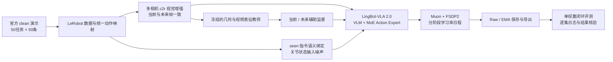

# LingBot-VLA 2.0 · RoboTwin 联合训练与泛化评测

基于 **LingBot-VLA 2.0（6B）** 的具身模型后训练项目：从数据接入、视觉与状态增强、分布式训练，到检查点选型、闭环评测和实验追踪，构建一条可审计的 RoboTwin 50 任务联合训练流程。

**Full-parameter post-training · Multi-view augmentation · Stateful checkpointing · Closed-loop evaluation**

[项目演进](#项目演进) · [实验结果](#实验结果) · [训练曲线](#训练曲线) · [方法实现](#方法实现) · [复现指南](docs/REPRODUCIBILITY.md) · [工程设计](docs/ENGINEERING.md)


## 项目演进

项目按 **v0流程验证 → v1正式基线 → v2视觉泛化 → v3精修与确认** 连续迭代。每一阶段都保留训练配置、指标来源、观察到的问题和下一步决策。

| 阶段 | 核心工作 | 实际训练 | 形成的下一步依据 |
|---|---|---|---|
| v0 | 打通数据、监督、训练和保存链路 | 1000步，global256 | 从可运行流程进入正式训练 |
| **v1** | **无视觉增强的全50任务基线** | **4600步，global1024** | 历史clean60.8/randomized34.4，识别泛化缺口 |
| v2 | c2r多视角视觉增强 | 20k日程，选19k检查点 | 泛化改善后进入平台期，转向精修 |
| v3 | 低LR、seen绑定、状态噪声；raw/EMA选型 | 从v2@19k权重续训4000步 | 4k raw完成1000集确认，均值65.6 |

阶段编号是项目版本，基座均为LingBot-VLA 2.0。v0、v1、v2分别从官方基座初始化，v3才直接继承v2；研究过程连续，权重谱系按实际记录展示。历史v1两setting都用unseen指令、exec50，不能与当前确认分直接作同口径涨幅计算。

[完整训练历程、阶段曲线与权重关系](docs/TRAINING_HISTORY.md)

## 实验结果

当前选定模型为 **v3 · step 4000 · raw**。2026-10-10 完成全部 **50任务 × 2 setting × 10集** 确认评测，成功数来自逐集策略执行记录，并与任务结果文件及日志交叉核验。

| Setting | 指令 | 成功 / 实际回合 | 成功率 |
|---|---|---:|---:|
| Clean | seen | 404 / 500 | **80.8%** |
| Randomized | unseen | 252 / 500 | **50.4%** |
| 两 setting 等权均值 | — | 656 / 1000 | **65.6%** |

推理配置：**FP32、动作块50、执行前30步后重新观测、10步去噪、torch.compile**。一份权重覆盖全部50任务。

这些是内部确认结果，不是官方排名或官方复测成绩。历史5集选型最高67.4%单独归档，不与本次10集结果混算。训练演示限定为官方clean2500条；历史归一化统计来源的待复核项见[数据与统计溯源](docs/DATA_PROVENANCE.md)。

- [机器可读结果](results/evaluation/v3_confirmation.json) · [1000集逐集记录](results/evaluation/v3_episodes.jsonl) · [评测协议](results/evaluation/protocol.json)
- [逐任务可视化](assets/figures/task_breakdown.png) · [检查点选型与负结果](docs/EXPERIMENTS.md)

## 训练曲线

三阶段统一展示，每阶段使用独立优化步横轴。v1/v2从原始TensorBoard事件恢复，v3来自W&B在线导出；原始trace与75条记录滑动均值同时显示，未插值补点。


| 阶段 | 指标记录 | 来源 | 详细图 |
|---|---:|---|---|
| v0 | 1000步 | [原始事件恢复](results/training/v0_provenance.json) | [CSV](results/training/v0_tensorboard.csv) |
| **v1** | **4600步** | [原始事件恢复](results/training/v1_provenance.json) | [v1完整训练图](assets/figures/training_v1.png) |
| v2 | 19000步 | [原始事件恢复](results/training/v2_provenance.json) / [W&B](https://wandb.ai/3120252125-/ant-lingbot-competition/runs/sft-v2-aug-c2r-v1-clean2500-20k) | [v2完整训练图](assets/figures/training_v2.png) |
| v3 | 3998条，覆盖4000步 | [W&B原始运行](https://wandb.ai/3120252125-/ant-lingbot-competition/runs/sft-v3-tail-v1-clean2500-parent19000-r2) / [导出来源](results/training/v3_wandb_provenance.json) | [v3完整训练图](assets/figures/training_v3.png) |

v1当时的W&B同步因兼容性问题失败，现从完整事件文件恢复；重启产生的重复记录按(step, metric)保留最新观测。W&B访问沿用原项目权限，仓库内图片/CSV可直接查看。训练loss用于复盘优化，最终选型依据闭环成功率。

## 方法实现



**视觉泛化。**训练期引入逐相机采样的光度、通道统计和频域扰动；同一相机的当前帧/未来帧复用参数。保留20%原图直通，将hue范围限制为±0.03，避免颜色语义任务的监督被破坏。实现：[augment.py](overlays/lingbot-vla-v2/lingbotvla/data/vla_data/augment.py)。

**语言与状态正则。**从官方seen模板恢复对象、手臂和空间关系，按episode绑定候选指令；歧义匹配保留原句。2159/2500条轨迹具备有效替换候选。状态噪声仅施加于有效连续关节，动作目标、夹爪和补齐维度保持原义。实现：[seen_bindings.py](overlays/lingbot-vla-v2/lingbotvla/data/vla_data/seen_bindings.py)、[数据变换](overlays/lingbot-vla-v2/lingbotvla/data/vla_data/utils.py)。

**阶段续训与恢复。**v3从v2@19k权重初始化，重建优化器和调度器，执行4000步cosine精修。阶段契约绑定父权重路径、配方与seen清单摘要；保存worker随机数、优化器与分片EMA状态，拒绝不兼容恢复。实现：[training_stage.py](overlays/lingbot-vla-v2/lingbotvla/checkpoint/training_stage.py)、[ema.py](overlays/lingbot-vla-v2/lingbotvla/checkpoint/ema.py)。

**评测可信度。**显式绑定clean→seen、randomized→unseen，缩短测试回合数时仍保持100条描述生成规模；记录专家筛选和策略成败，交叉检查实际回合、结果和日志。支持显式GPU映射、服务就绪检查及CPU线程控制。

完整设计与取舍见[方法说明](docs/METHOD.md)。

## 快速查看与复现

仅查看实验记录和重绘图表，无需GPU：

```bash
python -m pip install -r requirements-report.txt
python scripts/verify_results.py
python scripts/plot_results.py
```

准备固定版本上游源码并应用项目改动：

```bash
python scripts/setup_sources.py
# 按 docs/REPRODUCIBILITY.md 安装官方训练/仿真环境及模型、数据资产
python scripts/train.py --stage v3 --gpus 0,1,2,3 --dry-run
```

训练与评测入口分别为 `train.sh`、`eval.sh`；先查实际GPU占用，训练与评测串行。当前发布版完成了CPU与入口检查，完整硬件复现沿用已验证的工作区流程；跨机器从零复现仍需目标环境验证。详细步骤见[复现指南](docs/REPRODUCIBILITY.md)。

## 真机演示

附带一个独立的双臂字母块排列演示，用于展示语言条件化操作与多机位观测。它使用独立真机数据，不参与上面的RoboTwin训练或分数计算。

[](assets/demo/demo.mp4)

[观看完整演示](assets/demo/demo.mp4) · [演示说明](docs/DEMO.md)

## 仓库结构

```text
configs/          可迁移训练配方、版本锁与历史统计
scripts/          训练、评测、结果验证、制图与W&B同步
train.sh eval.sh  运行入口
overlays/         叠加到固定上游版本的项目改动
results/          W&B标量、确认结果、逐集记录与来源
assets/           曲线图、任务图和演示
runtime_patches/  H100 cuRobo运行时兼容处理
tests/            增强、语义绑定、EMA与恢复检查
docs/             方法、实验、工程设计与复现记录
```

模型权重、演示数据、仿真大资产和运行环境按原始发布渠道准备，不随代码仓库分发。

## 上游与许可

基于 [LingBot-VLA 2.0](https://github.com/Robbyant/lingbot-vla-v2) 与 [RoboTwin](https://github.com/RoboTwin-Platform/RoboTwin)，参与[天池蚂蚁灵波具身大模型挑战赛](https://tianchi.aliyun.com/competition/entrance/532514)。原生模型结构与预训练能力归属于上游；本仓库记录后训练、数据正则、恢复、实验追踪及评测工程改动。

代码采用Apache-2.0；上游和RoboTwin相关许可见[第三方说明](THIRD_PARTY.md)。
