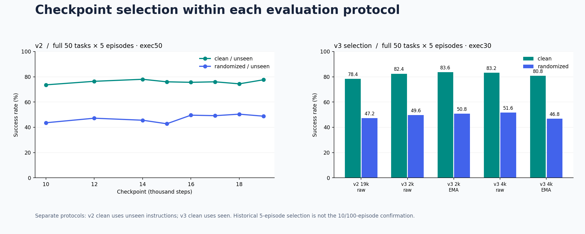

# v5/v7最终全量更新

v5和v7均已完成10000集，均分同为63.40%；最终选择v7。新结果和逐集证据见[v5](evaluation/v5.md)、[v7](evaluation/v7.md)和[最终对比](FINAL_TASK_RESULTS.md)。下文保留早期v0–v4历史档案，缺失/停止评测不改写成完整成绩。

---

# 全版本评测与迭代档案

快照时间：**2026-10-18T13:26:00+08:00**。

完整扫描现存 **72个评测目录**，其中 **57个有可核验的完整任务结果**。零结果启动、部分完成、负结果与正式结果均保留。

| 版本 | 运行目录数 | 有完整任务结果的运行数 | 本阶段做了什么 |
| --- | --- | --- | --- |
| [v0 · 流程验证](evaluation/v0.md) | 0 | 0 | 完成1000步训练，验证数据、监督、保存链路。原选点评测取消，现存评测目录中没有可核验的v0闭环成功率；不以零分代替缺失结果。 |
| [v1 · 正式基线与执行长度检查](evaluation/v1.md) | 14 | 7 | 从官方基座训练4600步，建立无视觉增强基线。目录中的4k是截断命名；实际加载记录为global_step_4600。包含全50任务、15任务面板、exec30/50及启动失败记录。clean历史指令为unseen。 |
| [v2 · 视觉增强、检查点扫描与协议修正](evaluation/v2.md) | 39 | 34 | 从基座重新训练，引入c2r增强，选用19k检查点。保留1k至19k面板/全任务结果、四检查点平均的负结果，以及exec30和clean/seen纠正后的独立评测。不同任务数或指令口径不合并。 |
| [v3 · 低学习率精修、raw/EMA选型与扩样](evaluation/v3.md) | 15 | 13 | 承接v2@19k，新增4000步低LR精修、seen绑定和状态噪声。保留2k/4k raw/EMA矩阵、每任务10集确认，以及当前每任务100集评测。五集67.4、十集65.6与百集62.71分开记录；百集已于2026-10-18完成。 |
| [v4 · 演示均衡续训与候选筛选](evaluation/v4.md) | 3 | 3 | 承接v3@4k，实际新增6000步；50%帧均匀＋50%演示均匀采样，保留原增强与配套归一化。训练已完成，3k/6k raw筛选均有记录。3k randomized完整为49.0%；其clean和6k筛选提前停止，不报完整双场均分。 |
| [environment · 环境验证记录](evaluation/environment.md) | 1 | 0 | 环境/官方模型锚点单独保留，不划为我们训练出的v0至v4模型成绩。 |

## 如何阅读版本间变化

v0、v1、v2分别从官方基座初始化；v3承接v2@19k，v4承接v3@4k。v4的3k/6k是该阶段新增步数，累计训练量分别约26k/29k。

早期clean/unseen、后期clean/seen，以及5集、10集、100集分开呈现。面板任务选择、指令抽样和执行长度变化都会影响成绩，不能把所有点连成一条同条件涨分曲线。

v2图仅取全50任务、exec50、两setting均unseen的检查点扫描；v3图为全50任务、exec30、clean/seen与randomized/unseen的五集选型。图中的连线只展示该组观测，不表示某一改动的因果贡献。

## 任务级数据与最新评测

[全版本逐任务CSV](../results/evaluation/all_task_results.csv) · [档案索引JSON](../results/evaluation/history/index.json) · [当前候选50任务表](TASK_RESULTS.md) · [两个逐集case](EVALUATION_CASES.md)

目录档案覆盖本次能读取的原始评测产物。v0选点评测取消，没有数值；不根据训练loss或旧文档中的粗略估计补造任务成绩。运行目录名中的时间戳按原样保留，不猜测早期生成脚本的时区。
