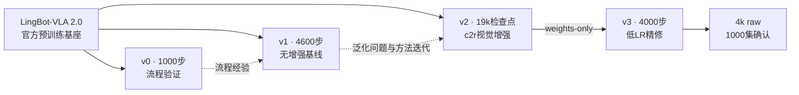

# 从 v0 到 v3：连续的项目演进

本项目围绕同一个目标迭代：用官方clean2500条演示训练一份覆盖RoboTwin50任务的策略，并提高randomized环境中的表现。这里的v0/v1/v2/v3是**项目实验阶段**，基座始终是LingBot-VLA 2.0（6B）。

## 阶段总览

时间按北京时间记录。曲线来自原始TensorBoard事件或W&B导出，配置和结果对应各自实验阶段。

| 阶段 | 时间 | 解决的问题 | 实际训练 | 推动下一步的观察 |
|---|---|---|---|---|
| v0：流程验证 | 9/17–9/18 | 数据、模型、辅助监督、分布式保存是否能完整跑通 | 1000步；global256；Muon；LR5e-5 | 流程可运行，但样本遍历与训练预算有限，进入正式基线阶段 |
| v1：正式基线 | 9/29–9/30 | 在全部50任务上建立可比较的起点 | 4600步；global1024；无视觉增强；LR1e-4→5e-5 | 历史全50任务clean60.8、randomized34.4，暴露跨场景泛化缺口 |
| v2：视觉泛化 | 10/1–10/6 | 保持动作学习骨架，增强对clean外观之外输入的适应 | 从官方基座重新训练；加入c2r；20k日程，取19k检查点 | randomized改善，但中后期闭环收益趋于平台，转向低LR精修 |
| v3：精修与确认 | 10/8–10/10 | 在已有视觉鲁棒性上改善动作拟合和输入稳定性 | v2@19k权重初始化；4000步；LR2e-5→2e-6；seen绑定、状态噪声、EMA候选 | 选定4k raw，并完成50×2×10确认：80.8/50.4，均65.6 |

这条时间线描述经验和工程的连续积累。**v1并不是v0权重续训，v2也不是v1权重续训；只有v3直接继承v2@19k。**



## v0：先建立完整训练链路

从官方预训练基座出发，使用相同clean演示源和原生几何/视频辅助监督，完成1000步训练。实际批量为micro8 × 2卡 × accum16 = global256。该阶段用于验证输入、loss、checkpoint和推理接口；没有可用于代表最终性能的完整确认评测。

保留[原始配置档案](../configs/history/v0_original.yaml)、[1000步指标](../results/training/v0_tensorboard.csv)和[事件文件溯源](../results/training/v0_provenance.json)。

## v1：4600步正式基线

v1重新从官方基座初始化，global1024，Muon，cosine学习率1e-4→5e-5，关闭视觉增强。原历史配置为micro32 × 8卡 × accum4；本仓库另提供4卡、accum8的等全局批量便携配置，两者清楚区分。


**训练记录完整恢复到4600步。**该阶段包含重启和重复记录，发布曲线按每个(step, metric)保留最新wall_time的观测，没有补点或插值。原始事件文件摘要可追溯。

当时W&B同步桥因NumPy 2.x的`np.string_`兼容问题失败，桥接日志没有成功指标上传链接。因此曲线标注为TensorBoard恢复，不伪装成历史W&B在线导出。训练执行运行另有[W&B记录](https://wandb.ai/3120252125-/lingbot-vla-v2-tasks_vla/runs/0wkds852)。

全50任务×5集的历史结果：clean **152/250=60.8%**，randomized **86/250=34.4%**。两边当时均为unseen指令，exec50。该协议不等于当前clean/seen、exec30的确认协议，不能据两者差值宣称单变量涨分。

[原始配置档案](../configs/history/v1_original.yaml) · [4卡便携配置](../configs/v1.yaml) · [曲线CSV](../results/training/v1_tensorboard.csv) · [历史逐任务结果](../results/evaluation/v1_4600_exec50.json)

## v2：针对泛化缺口开展视觉增强训练

v1暴露了clean与randomized之间的差距。v2从官方基座重新训练，保留Muon、动作损失、global1024和原生辅助监督，引入c2r的光度、通道统计和频域扰动；同相机当前/未来帧共享参数。它是新的训练实验，并非将v1继续训练到19k。


保留20k学习率日程，在19k检查点结束主阶段。事件中还有保存/停止期间的少量后续记录；发布曲线显式截至选用的19k检查点，不把它们算入该模型的训练曲线。

历史exec50、两边unseen口径下，全50任务×5集结果为clean **194/250=77.6%**、randomized **122/250=48.8%**。后来切换到exec30并纠正clean指令口径后，v2@19k为78.4/47.2。两组结果分别保存和解释，不拼接成新的模型成绩。

早期同15任务面板中，v2@3k的randomized已优于v1@4.6k，支持保留增强；但训练日程、样本和阶段变化没有完全匹配，不能将最终差值全部归因于c2r。中后期训练loss继续下降而闭环收益趋于平台，成为v3低LR精修的依据。

[曲线CSV](../results/training/v2_tensorboard.csv) · [来源与重启处理](../results/training/v2_provenance.json) · [原W&B指标运行](https://wandb.ai/3120252125-/ant-lingbot-competition/runs/sft-v2-aug-c2r-v1-clean2500-20k) · [历史exec50结果](../results/evaluation/v2_19000_exec50.json)

## v3：从19k父权重做低LR精修

v3加载v2@19k raw权重，重新建立优化器与4000步日程。保留c2r，新增seen语义绑定与关节状态噪声，并同时维护raw/EMA候选。2k/4k选型后采用4k raw，再完成1000集确认。


v3曲线来自已结束的[W&B运行](https://wandb.ai/3120252125-/ant-lingbot-competition/runs/sft-v3-tail-v1-clean2500-parent19000-r2)，导出3998条指标，覆盖step1–4000。2026-10-18完成百集全量后，当前主成绩为78.04/47.38/62.71；80.8/50.4/65.6保留为十集确认，67.4保留为五集选型值。

## v4：演示均衡续训与候选筛选

从v3@4k raw初始化，新增6000步，累计谱系29k；global1024，200步warmup 2e-6→1e-5后cosine→2e-6。采样为50%帧均匀＋50%演示均匀后取帧，继续原配套归一化。


原始TensorBoard共6000步，未插值或补点。3k/6k raw与EMA均已保存；已评的3k raw randomized为49.0%，3k clean和6k randomized提前停止，保留部分计数，不报双场均分。当前v3仍为主候选。

[v4训练配方](../results/training/v4_recipe.json) · [完整指标](../results/training/v4_tensorboard.csv) · [所有v4评测与任务明细](evaluation/v4.md)

## 连续项目中保留了什么

- 数据接入与训练自检，从v0延续到后续阶段。
- v1揭示的泛化缺口，推动v2的增强实验。
- v2的平台期与训练曲线，推动v3的低LR日程。
- v3之后的均衡续训形成v4，已发生的负结果和未完成筛选同样归档。
- 中断恢复、语义绑定、W&B指标同步和逐集审计在迭代中逐步补齐。
- 正负结果、协议更正和实际数据统计记录均保留，避免只展示最终最好的一次数字。

全阶段索引：[stages.json](../results/training/stages.json)。历史曲线用于复盘过程，不将不同阶段的loss横轴强行拼成一次连续优化，也不将不同协议的成功率画成严格同条件收益。

## 从原始事件重新导出

在带TensorBoard的训练环境中运行：

```bash
python scripts/export_tensorboard.py --events-dir /path/to/v1/runs --max-step 4600 --output outputs/v1_recovered.csv
```

导出器仅处理标量、记录重复步策略和文件摘要，不启动训练或创建W&B运行。仓库现有CSV可直接重绘，不依赖外部账户权限。
